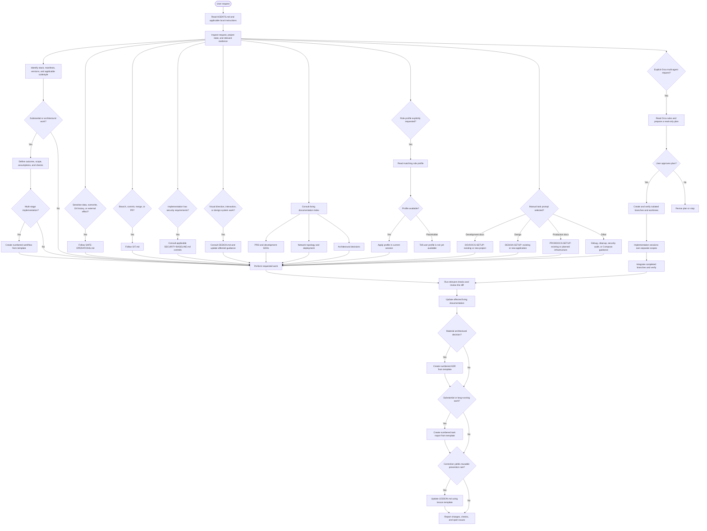

# AgentKnowledge

AgentKnowledge installs shared agent guidance, prompts, and document templates into software projects with a local CLI. It does not require npm publishing or an npm registry.

## Agent workflow

[AGENTS.md](AGENTS.md) is the entry point for shared project guidance. Task-specific and more specific instructions apply where relevant. The agent inspects the request and project evidence, selects applicable guidance, and keeps changes within the requested scope.



This is a decision guide, not a requirement to create every artifact for every task. During work, revisit assumptions when evidence changes and request input when a consequential decision remains unresolved. Record a task report for substantial or long-running work; create an ADR for a material architectural decision. Record user corrections in `LESSON.md` only when they yield a reusable prevention rule.

### Guidance selected by task


| Situation                                                                                | Guidance                                                                                                                                                                |
| ---------------------------------------------------------------------------------------- | ----------------------------------------------------------------------------------------------------------------------------------------------------------------------- |
| Sensitive data, deletion or overwrite, Git history or branches, or external side effects | [Safe operations](.agent-knowledge/static/rules/SAFE-OPERATIONS.md)                                                                                                     |
| Branch, commit, merge, or pull request                                                   | [Git workflow](.agent-knowledge/static/rules/GIT.md)                                                                                                                    |
| Security requirements during implementation                                              | Applicable controls in [security baseline](.agent-knowledge/static/rules/SECURITY-BASELINE.md)                                                                          |
| Project stack and testing                                                                | Matching guides in [codestyle](.agent-knowledge/static/rules/codestyle/); shared practices are in [coding standards](.agent-knowledge/static/rules/CODING-STANDARDS.md) |
| UI direction, interactions, or design system                                             | Root [DESIGN.md](DESIGN.md); update affected guidance as decisions and implementation evolve                                                                            |
| Explicit multi-agent work in Orca                                                        | [Orca orchestration](.agent-knowledge/static/rules/ORCA-ORCHESTRATION.md)                                                                                               |


Inspect manifests, lockfiles, runtime versions, and tool configuration before running project commands or changing dependencies. Follow the project's declared versions and scripts. The safety rules also govern authorization for external actions and handling of secrets.

### Repository structure


| Path                                         | Purpose                                                                                                                                 |
| -------------------------------------------- | --------------------------------------------------------------------------------------------------------------------------------------- |
| `.agent-knowledge/static/rules/`             | Safety, Git, security, orchestration, coding, stack-specific, and anti-slop guidance.                                                   |
| `.agent-knowledge/static/commands/`          | Task-specific prompts, invoked manually when relevant.                                                                                  |
| `.agent-knowledge/static/agents/`            | Role profiles, read in the current session when explicitly requested.                                                                    |
| `.agent-knowledge/static/templates/`         | Canonical structures for documents and records; copy the structure into the output rather than editing the template.                    |
| `.agent-knowledge/dynamic/docs/`             | Living product, design, security, and production documentation; see the [documentation index](.agent-knowledge/dynamic/docs/README.md). |
| `.agent-knowledge/dynamic/docs/notes/`       | ADRs and specifications created for the project.                                                                                        |
| `.agent-knowledge/dynamic/workflows/`        | Numbered execution plans for substantial multi-stage implementation.                                                                    |
| `.agent-knowledge/dynamic/reports/tasks/`    | Numbered reports for substantial or long-running work.                                                                                  |
| `.agent-knowledge/dynamic/reports/LESSON.md` | Reusable prevention rules, not a chronological log.                                                                                     |


Use the highest existing number plus one for each numbered document type, starting at 1. Recheck the destination and numbering before creating a file, especially when work runs in parallel. Living document files in this checkout are initial placeholders; populate them with project evidence or approved plans, and keep current behavior distinct from proposals and open questions.

### Manual prompts

These are Markdown instructions to give to an agent, not CLI subcommands. Read the selected file and follow its scope and decision points:


| Prompt                                                                      | Purpose                                                                                              |
| --------------------------------------------------------------------------- | ---------------------------------------------------------------------------------------------------- |
| [DEVDOCS-SETUP](.agent-knowledge/static/commands/setups/DEVDOCS-SETUP.md)   | Initialize or refine the PRD and development SDDs for an existing or new project.                    |
| [DESIGN-SETUP](.agent-knowledge/static/commands/setups/DESIGN-SETUP.md)     | Initialize or update root `DESIGN.md` for an existing or new application.                            |
| [PRODDOCS-SETUP](.agent-knowledge/static/commands/setups/PRODDOCS-SETUP.md) | Document existing or planned network topology and deployment.                                        |
| [DEBUG](.agent-knowledge/static/commands/DEBUG.md)                          | Diagnose a reported bug before proposing a minimal fix.                                              |
| [CLEANUP](.agent-knowledge/static/commands/CLEANUP.md)                      | Audit cleanup candidates, then execute only the approved scope.                                      |
| [SECURITY-AUDIT](.agent-knowledge/static/commands/SECURITY-AUDIT.md)        | Perform a read-only pre-launch security review and report findings.                                  |
| [DOCKER-COMPOSE](.agent-knowledge/static/commands/DOCKER-COMPOSE.md)        | Apply Compose, container, and verification guidance when creating or changing Compose configuration. |


Development documentation includes PRD, architecture, technology stack, database, authentication, authorization, and security. Production documentation covers network topology and deployment. The setup prompts specify their own mode selection, evidence, and safety requirements; templates are examples and structural guides, not proof of a project's actual configuration.

### Manual role profiles

Explicitly name a role to have the current agent read its profile, for example: “Use ui-designer to review this onboarding flow.” A profile supplies role-specific guidance in the current session; it does not automatically start a separate agent. Project rules and the user's instructions still apply.

The following profiles are available for explicit use:

- [ui-designer](.agent-knowledge/static/agents/ui-designer.md)
- [code-reviewer](.agent-knowledge/static/agents/code-reviewer.md)
- [security-engineer](.agent-knowledge/static/agents/security-engineer.md)
- [technical-writer](.agent-knowledge/static/agents/technical-writer.md)
- [desktop-engineer](.agent-knowledge/static/agents/desktop-engineer.md)
- [mobile-engineer](.agent-knowledge/static/agents/mobile-engineer.md)
- [document-generator](.agent-knowledge/static/agents/document-generator.md)
- [ai-engineer](.agent-knowledge/static/agents/ai-engineer.md)
- [tester](.agent-knowledge/static/agents/tester.md)

When writing a profile, describe its purpose, scope, workflow, expected output, and any related guidance to consult.

## Optional Orca workflow: plan → isolated scopes → integration

When a user explicitly asks for multi-agent orchestration, role separation, or parallel work in Orca, first use a read-only planning session. It defines the scope, contracts, file ownership, dependencies, acceptance criteria, and integration approach; implementation begins only after the user explicitly approves that plan.

For each independent scope, create a feature branch and a genuinely separate worktree before opening its implementation session. One writing session owns each branch and its files. Verify the branch and physical checkout for every session—multiple Orca workspaces pointing to the same checkout are not isolated and must not be used for parallel writers.

Each implementation session changes only its approved scope, runs its relevant checks, and reports its commit, changed files, verification, and blockers. A dedicated integration session merges completed feature scope branches into `develop`, runs combined verification, and follows the Gitflow review or pull-request process: production changes reach `main` only through a reviewed `release/*` or `hotfix/*` branch. The workflow is provider-agnostic and has no automatic review-agent stage.

### Orca request examples

Use an explicit request when a task needs a handoff, a dependent sequence, or isolated parallel scopes. A handoff should name the goal, current context, relevant files or worktree, expected result, and next action.

> Use /orchestration to hand this billing settings task to the idle Claude agent. Include the goal, current context, and what they should finish next.

> Use /orchestration to hand this settings cleanup to the agent in the settings-polish worktree. Send the goal, relevant files, and expected result.

> Use /orchestration to run this auth refactor in phases: plan, backend, UI, then tests. Start each child agent after the previous phase is done.

> Use /orchestration to split this auth refactor across parallel child agents: API contract, backend call sites, UI flow, and test gaps.

> Use /orchestration to split this onboarding update into smaller PRs, each in its own child worktree: setup state, settings UI, copy, and tests.

## Recommended Skills

Optional agent skills for focused workflows. Use them when they fit the task and are available in your agent environment.


| Skill                                                                         | Recommended use                                           |
| ----------------------------------------------------------------------------- | --------------------------------------------------------- |
| [codebase-memory](https://github.com/DeusData/codebase-memory-mcp)            | Structural codebase questions and impact analysis.        |
| [impeccable](https://github.com/pbakaus/impeccable)                           | UI and UX design, review, and refinement.                 |
| [Taste Skill](https://github.com/leonxlnx/taste-skill)                        | Stronger visual direction and frontend design quality.    |
| [Matt Pocock's Skills](https://github.com/mattpocock/skills)                  | Engineering workflows and reusable development practices. |
| [OWASP Secure Agent Playbook](https://github.com/OWASP/secure-agent-playbook) | Security reviews, audits, and agent security workflows.   |


## Recommended MCP Servers

Optional tool integrations. Use them when they match the task and are available in your agent environment.


| MCP server                                                                                                  | Recommended use                                                                       |
| ----------------------------------------------------------------------------------------------------------- | ------------------------------------------------------------------------------------- |
| [FigCraft MCP](https://github.com/storytold/figcraft)                                                       | Create and edit designs, inspect documents as JSON, and render previews.              |
| [Pencil MCP](https://github.com/highagency/pencil-desktop-releases)                                         | Reading or editing Pencil designs and `.pen` files.                                   |
| [Playwright MCP](https://github.com/microsoft/playwright-mcp)                                               | Browser-based user flows and end-to-end checks.                                       |
| [Chrome DevTools MCP](https://github.com/ChromeDevTools/chrome-devtools-mcp)                                | Runtime diagnostics for console, network, styles, performance, or memory.             |
| [Context7 MCP](https://github.com/upstash/context7)                                                         | Current documentation for libraries, frameworks, SDKs, APIs, CLIs, or cloud services. |
| [codebase-memory-mcp](https://github.com/DeusData/codebase-memory-mcp)                                      | Persistent knowledge graph for code discovery, call-path tracing, and impact analysis. |
| [Sequential Thinking MCP](https://github.com/modelcontextprotocol/servers/tree/main/src/sequentialthinking) | Complex or uncertain multi-step analysis and planning.                                |


## Requirements

- Node.js 18 or newer
- A checkout of this repository

## One-time setup

From this repository, run:

```
node install.mjs
```

The installer copies the current configuration into your per-user application directory, creates a launcher, and adds its directory to your user PATH. Existing AgentFoundry installations are left untouched: they are not moved, updated, aliased, or removed. Open a new terminal after setup.

## Use from a software project

From the project directory, install the configuration into the current project:

```
agent-knowledge init
```

The CLI installs `AGENTS.md` and `.agent-knowledge/`. It does not install the root `DESIGN.md` or the optional skills and MCP servers listed above; create or configure those separately when needed. Bundled task reports are excluded, and the installed `LESSON.md` starts empty.

Pass a target directory to install somewhere else:

```
agent-knowledge init ./my-project
```

The CLI merges directories and asks before replacing each conflicting file in an interactive terminal. If conflicts exist in a non-interactive environment, it stops before writing. Use --force to replace all conflicting files:

```
agent-knowledge init ./my-project --force
```

`--force` replaces files that conflict with the bundled configuration, including existing living documentation and lessons at matching paths. It does not remove unrelated files. Review conflicts and preserve project-specific content before using it.

## Updating the installed configuration

Update this repository to the revision you want, then run node install.mjs again from the checkout. The installer refreshes its managed local copy. Existing projects are not changed; run agent-knowledge init in each project to apply updates there.

## Development checks

Run the local test suite without npm:

```
node --test
```

Vendored skills retain their own license and notice files. The top-level license applies to the CLI and original configuration materials; consult each vendored skill's notices for its terms.

## Prompt for first time before ask ai

I want a deeper version of this task, not a bigger one. Before rewriting it:   
(1) say what a top professional in this field would do here that I’m not asking for;   
(2) name the rawest material they would start from instead of what has already been digested for me;   
(3) name the specific methods and tools they would use;   
(4) say what, other than you or me, would show the result is right. Then rewrite my prompt to ask for exactly that;
(5) Observe and follow all instructions, rules, and personas outlined in the agents.md file.
